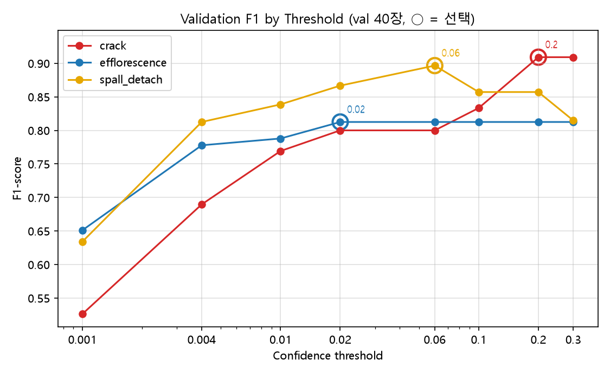
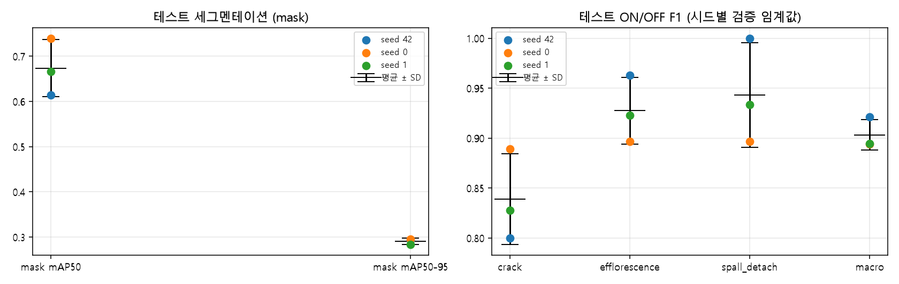
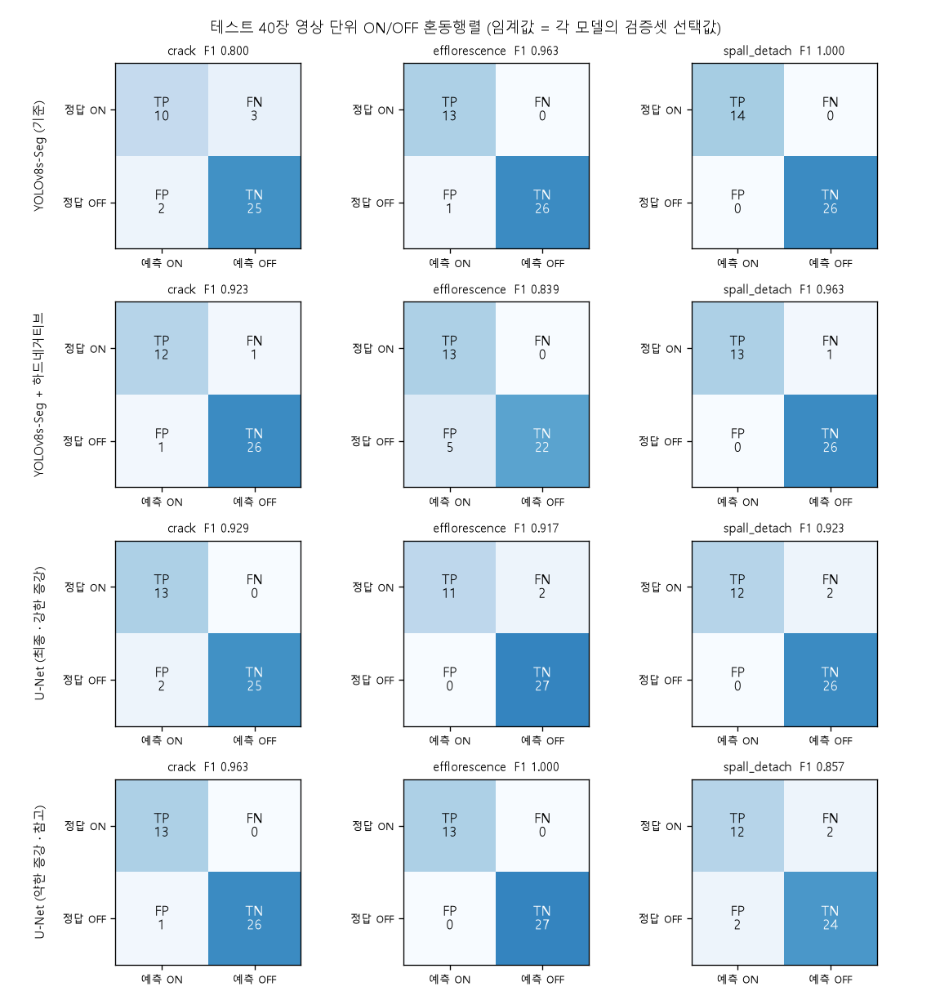
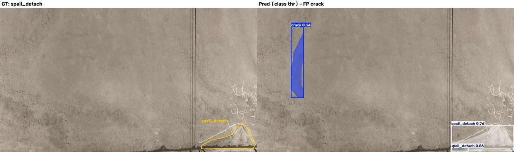
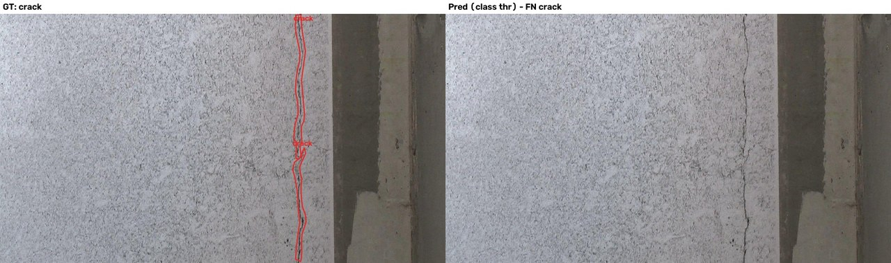
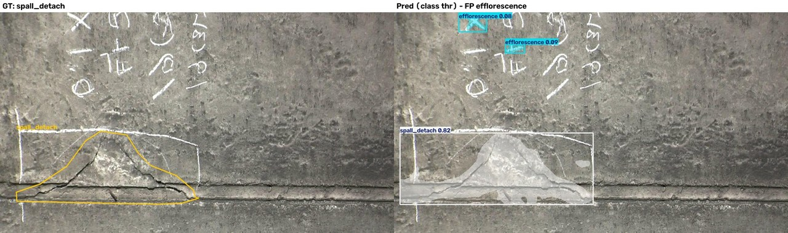
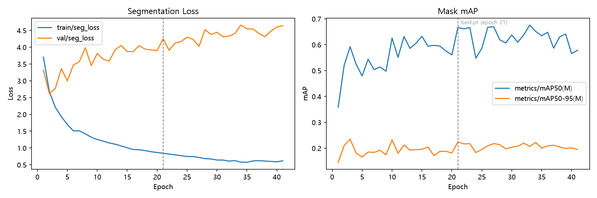

# 지하 콘크리트 구조물 표면결함 세그멘테이션 — YOLOv8s-Seg 재현 · 모델 비교

대구가톨릭대학교 「딥러닝프로그래밍」 Step 3 과제 (21113103 김근영)

- 재현 대상 논문: Kim, Kim, Kong, Lee & Choi, *Detection and Segmentation of Multiple Surface Defects in Underground Concrete Structures Using YOLOv8s-Seg*
- 데이터: 수업에서 제공받은 지하 콘크리트 구조물 영상(AI Hub 공개 데이터 기반, 4,116장, YOLO 세그멘테이션 라벨 포함). 저장소에는 넣지 않았다(1.5절).
- 문제: 영상 한 장에서 결함 3종 `crack`(균열) · `efflorescence`(백태) · `spall_detach`(박리 · 박락)의 위치를 **픽셀 마스크**로 찾고(세그멘테이션), 영상마다 각 결함이 **있는지 없는지**(ON/OFF)를 판정한다.

## 한눈에 보는 결과

| 항목 | 논문 | 본 재현 (YOLOv8s-Seg, seed 42) |
|---|---|---|
| 테스트 mask mAP50 / mAP50-95 | 0.443 / 0.222 | **0.614 / 0.293** |
| 클래스별 테스트 mask mAP50 (crack / efflo / spall) | – | 0.613 / 0.328 / 0.900 |
| 검증셋에서 고른 임계값 (crack / efflo / spall) | 0.010 / 0.004 / 0.060 | 0.2 / 0.02 / 0.06 |
| 검증 macro F1 | 0.878 | 0.873 |
| 테스트 ON/OFF macro F1 | 0.896 | **0.921** (95% CI 0.841 \~ 0.976) |
| 테스트 F1 (crack / efflo / spall) | 0.880 / 0.880 / 0.929 | 0.800 / 0.963 / 1.000 |
| 시드 3개 반복 (42 · 0 · 1) | 하지 않음 (논문 한계 04) | mAP50 0.673 ± 0.063 · macro F1 0.903 ± 0.015 |
| 모델 비교 | 하지 않음 (논문 한계 04) | U-Net 최종 macro F1 0.923 · 픽셀 IoU 0.497 (YOLO 0.426) |
| 클래스별 vs 공통 임계값 | 직접 비교 없음 | 클래스별이 테스트 macro F1 +0.043 (0.921 vs 0.878) |

- 같은 절차(검증셋에서 임계값 결정 → 테스트에 고정 적용)를 지켰는데 테스트 숫자가 논문보다 높게 나왔다. 숨기지 않고 왜 다른지 4.2절에 정리했다. 가장 큰 이유는 **받은 데이터의 테스트셋 구성이 논문과 다르다**는 점이다(논문 테스트 정답 영상 crack 13 · efflo 12 · spall 15, 우리는 13 · 13 · 14).
- 테스트는 40장뿐이라 영상 1장이 F1을 약 0.03 \~ 0.04 움직인다. 네 모델의 macro F1 차이는 모두 bootstrap 95% CI 안에 들어 **40장으로는 어느 모델이 낫다고 말할 수 없다**(2.4절).
- 직접 주석한 2장으로 모델을 더 좋게 만들려 했지만 실패했다(심화 ⑦, 부록 C). 같은 조건의 대조군보다는 3시드 모두 조금 나았지만(mAP50 평균 +0.034), 기준 모델(0.614)은 넘지 못했다(0.591 ± 0.034).

3주차 최종 제출물(실습자료 17쪽)이 이 저장소의 어디에 있는지:

| 제출물 | 위치 |
|---|---|
| ① 리포트 (문제정의 · 데이터 · 방법 · 결과 · 오류분석 · 한계 · 재현정보) | 이 README 전체 (아래 표) |
| ② 주석기준서 수정본 | [week3/annotation_guideline_v0.3.md](week3/annotation_guideline_v0.3.md) (1주차 v0.2 → v0.3, 변경표 포함) |
| ③ 세그멘테이션 성능 (테스트 mask mAP50 · mAP50-95 + 클래스별) | 2.1절 · [week3/seg_metrics.md](week3/seg_metrics.md) |
| ④ 임계값 F1 곡선 (검증셋, 선택 임계값과 근거) | 2.2절 · [week3/val_threshold_f1.png](week3/val_threshold_f1.png) · [week3/val_threshold.md](week3/val_threshold.md) |
| ⑤ ON/OFF 결과표 (테스트 TP · FP · FN · TN · P · R · F1 + macro F1) | 2.3절 · [week3/onoff_test.md](week3/onoff_test.md) |
| ⑥ 오류 사례 (클래스별 대표 FP · FN + 원인) | 3.2절 · [week3/error_cases/](week3/error_cases/) · [week3/error_cases.md](week3/error_cases.md) |

| 리포트 항목 (실습자료 14쪽) | 위치 |
|---|---|
| 1. 문제 정의 (세 결함 정의 · 세그멘테이션을 고른 이유 · 평가 목표) | 1.1 |
| 2. 데이터 (주석 기준 요약 · 규모 · 클래스 구성 · 원본 단위 분할) | 1.2 · 부록 A · B |
| 3. 방법 (YOLOv8s-Seg 설정 · imgsz 960 · Mosaic/MixUp 끈 근거) | 1.3 · 1.4 |
| 4. 결과 (mAP + ON/OFF 표 + 검증셋 F1 곡선) | 2 |
| 5. 오류 분석 (클래스별 FP · FN 사례와 원인) | 3 |
| 6. 한계 (테스트 규모 · 물리 단위 불가 · 단일 모델 등) | 4.4 |
| 7. 재현 정보 (환경 · seed · data.yaml · 설정 · 실행 순서) | 1.5 · 5 |

---

## 1. 코드 설명

### 1.1 문제 정의

| 결함 | 정의 (주석기준서 ①) |
|---|---|
| crack (균열) | 콘크리트 표면의 선형 · 분기형 · 망상형 불연속. 수분 · 유해물질의 침투 경로 |
| efflorescence (백태) | 수분 이동으로 표면 위에 생긴 백색 · 담색 침착물. 누수의 지표 |
| spall_detach (박리 · 박락) | 표면층이 들뜨거나 벗겨진 영역(박리), 재료가 떨어져 나간 영역(박락). 영상으로 구분이 어려워 한 클래스 |

- **세그멘테이션을 고른 이유:** 분류는 '결함이 있다'만, 검출은 상자만 준다. 균열은 가늘고 길며 백태 · 박리는 모양이 불규칙해서 상자로는 범위를 나타낼 수 없다. 위치와 범위를 픽셀로 남겨야 점검 기록과 비교 · 추적이 된다.
- **평가 목표 (두 축):** ① mask mAP50 · mAP50-95 = 경계와 위치가 얼마나 맞는가, ② 영상 단위 ON/OFF macro F1 = 결함이 있는 영상을 얼마나 잘 골라내는가(실무 선별). 성공 기준은 논문 절차(검증셋에서 클래스별 임계값 결정 → 테스트 고정 적용)를 그대로 지키면서 논문 수준(mAP50 0.443 · macro F1 0.896)을 재현하는 것.
- 이 모델의 자리는 **판정 도구가 아니라 의사결정 지원 도구**다(논문강의 44쪽). 결함 가능성이 높은 영상과 후보 영역을 먼저 보여 주고, 균열 폭 · 누수 · 철근 부식 · 구조적 중요도 판단은 점검자가 한다.

### 1.2 사용한 데이터 및 전처리

- **규모:** 제공 4,116장(train 4,036 · val 40 · test 40, 모두 1920×1080 원본 또는 그 증강본). train 4,036장 중 3,916장은 증강본(파일명 `_aug` · `_efflo_`)이고 120장이 원본이다(원본은 train 120 · val 40 · test 40 = 200장). val · test에는 증강본이 없다(파일명 기준 40/40장 확인).
- **무결성:** 0바이트 영상 63장(train)을 뺐다. 라벨 파일은 있었지만 영상을 읽을 수 없다(부록 A).
- **누수 제거:** test의 `URT017_2020_02_08_001_24512`와 train 원본이 픽셀 상관 1.000(같은 영상의 재인코딩)이었다. 그 원본과 증강본 55장을 train에서 뺐다.
- **원본 ID 단위 분할:** 파일명에서 원본 ID(`_aug` · `_efflo_` · `_jpg.rf.` 앞부분)를 뽑아 같은 원본에서 나온 영상이 한 split에만 들어가게 했다. 결과는 train 3,918 · val 40 · test 40장(원본 ID 119 · 40 · 40)이고, split 사이 원본 ID 겹침은 0이다([week2/split_report.md](week2/split_report.md)).
- **클래스 구성** ([week3/data_stats.md](week3/data_stats.md)):

| split | crack 영상 / 인스턴스 | efflorescence 영상 / 인스턴스 | spall_detach 영상 / 인스턴스 |
|---|---:|---:|---:|
| train (증강 포함 3,918장) | 716 / 1,050 | 885 / 1,783 | 2,317 / 2,615 |
| train 원본만 (118장) | 23 / 31 | 24 / 47 | 71 / 89 |
| val (40장) | 10 / 10 | 17 / 27 | 13 / 16 |
| test (40장) | 13 / 14 | 13 / 19 | 14 / 14 |

- **주석 기준 요약** ([v0.3](week3/annotation_guideline_v0.3.md)): '보이는 것만 그린다'. crack은 보이는 폭만큼, 이어진 균열은 한 인스턴스로 그린다. 시공이음부 · 케이블 · 그림자 · 분필 · 정반사 · 시설물 부착물 등은 제외 대상이다. 확신할 수 없는 영상은 판단 보류 목록으로 따로 뺀다. ★ 제공 데이터의 crack 라벨은 실제 균열(약 3px)보다 훨씬 넓은 띠(약 37px)다. 기준서는 '보이는 폭'을 유지하고, 이 차이는 한계로 적었다(4.4절).
- **전처리:** 따로 하지 않는다. YOLO가 960 letterbox로 줄이고, 증강은 ultralytics 기본값(좌우 뒤집기 0.5 · HSV · translate 0.1 · scale 0.5 · erasing 0.4)을 쓴다. Mosaic · MixUp만 끈다(1.3절).

### 1.3 사용한 모델

| 모델 | 구조 | 학습 설정 | 역할 |
|---|---|---|---|
| **YOLOv8s-Seg** (본 실험) | CSP 백본 + FPN/PAN + 검출 헤드 + 프로토타입 마스크 헤드, 11.8M 파라미터, COCO 사전학습 | imgsz 960 · batch 4 · AdamW lr0 0.00015 · 60 epoch · patience 20 · Mosaic 0 · MixUp 0 · seed 42 (논문 Table 1 = 강의 13쪽) | 기준 · 논문 재현 |
| YOLOv8s-Seg + 하드네거티브 | 같음 | 같은 설정 · 같은 seed, train에 사람이 확인한 배경 영상 54장 추가 | 심화 ③ |
| **U-Net** (resnet34 인코더, ImageNet 사전학습) | 인코더-디코더 + skip, 출력 3채널 sigmoid(클래스마다 따로 — 한 픽셀에 두 결함이 겹칠 수 있음), 24.4M 파라미터 | 960×544 · BCE + Dice(배치 합산) · AdamW lr 1e-4(코사인 감소) · 기울기 클리핑 1.0 · seed 42 · 최대 40 epoch · patience 10, 최종 = 강한 증강(scale 0.5 \~ 1.5 · translate 0.1 · HSV) | 모델 비교 (심화 ②) |

- **imgsz 960을 쓴 이유:** 원본이 1920×1080이고 균열 폭은 약 3px다. 기본 640으로 줄이면 1/3이 되어 균열이 1px 수준으로 사라진다. 960이면 절반 크기라 가는 균열 특징이 더 남는다(논문 한계 03 '입력 960 리사이즈'도 같은 문제를 말한다).
- **Mosaic · MixUp을 끈 이유:** Mosaic은 네 장을 잘라 붙여 큰 박리 · 백태 영역을 자르고, 벽면 맥락(이음부 · 케이블 위치)을 깨뜨린다. MixUp은 두 영상을 반투명하게 겹쳐 백태의 '흰색 두께감'과 반사 · 얼룩의 차이를 흐린다. 논문 설정(Table 1)도 둘 다 껐다.
- **모델 선택(best.pt):** 학습 손실이 아니라 검증 성능으로 고른다. YOLO는 ultralytics fitness(검증 mAP50-95 box + mask)가 가장 높은 epoch이고, U-Net은 검증 mIoU가 가장 높은 epoch이다.
- **U-Net 영상 점수:** U-Net은 인스턴스 신뢰도가 없다. 그래서 '확률 0.5 이상인 픽셀 면적 비율'을 영상 점수로 쓰고, 그 임계값을 검증셋에서 고른다. 처음 쓴 '확률 최댓값'은 포화돼서(정답 영상 0.9992 이상, 결함 없는 영상도 0.999 \~ 1.0) 임계값이 의미가 없었다. 비교용 행으로만 남겼다([week3/adv2_unet_aug.md](week3/adv2_unet_aug.md)). U-Net은 인스턴스를 내지 않아 mask mAP는 계산할 수 없다. 대신 ON/OFF F1과 픽셀 IoU로 비교한다.

### 1.4 학습 및 테스트 방법

1. **학습:** train 3,918장으로 학습하고, 매 epoch 검증 40장으로 best.pt를 고른다(기준 모델 = epoch 21, 41 epoch에서 조기 종료, 2.31시간).
2. **단계1 세그멘테이션 평가:** best.pt로 test(+ 참고용 val) mask mAP50 · mAP50-95를 잰다(`model.val`).
3. **단계2 ON/OFF 판정 함수:** 영상마다 '그 클래스 예측 중 신뢰도가 임계값 이상인 것이 하나라도 있으면 ON'으로 판정하고, 정답 라벨에 그 클래스가 있으면 정답 ON으로 둔다(강의 10쪽 코드). 예측은 conf 0.001로 한 번 해서 저장해 두고, 임계값만 바꿔 다시 판정한다(강의 코드의 기본 conf 0.25면 0.25 미만 임계값이 모두 같은 결과가 된다).
4. **단계3 임계값 탐색 (검증셋만):** 0.001 · 0.004 · 0.01 · 0.02 · 0.06 · 0.1 · 0.2 · 0.3(논문 Table 3) 중 클래스마다 검증 F1이 가장 큰 값을 고른다. 동점이면 낮은 쪽(재현율 우선)이다. 결과는 `thresholds.json`에 검증 영상 목록의 해시와 함께 저장한다.
5. **단계4 테스트 고정 적용:** `thresholds.json`을 읽기만 한다. 테스트 결과를 보고 임계값을 바꾸지 않는다.
6. **단계5 오류 분석:** 클래스별 FP · FN 영상을 [정답 | 예측] 두 칸 그림으로 뽑아 직접 보고 원인을 적는다.

- **절차를 지킨 증거:** [week3/run_log.txt](week3/run_log.txt)에 실행 시각이 쌓인다. `step3_threshold`(검증셋, sha 123d40a69aca)가 `step4_test`보다 먼저 실행됐고, step4는 json의 값을 그대로 썼다. 같은 순서로 다시 돌려도 같은 임계값 · 같은 결과가 나온다. 2026-11-16 첫 실행과 2026-11-20 · 11-21 재실행 기록이 모두 있다(매번 같은 임계값 · 같은 macro F1 0.921). run_log의 `adv1_common_threshold`는 이름을 바꾸기 전 기록이고, 지금 파일은 `adv4_common_threshold.py`다.
- 심화 모델(시드 · 하드네거티브 · U-Net · 타일)도 각자 검증셋에서 임계값을 고르고 테스트에 고정 적용한다(`adv_eval_run.py` · `adv2_unet_eval.py` · `adv1_tile.py`).

### 1.5 실행 방법

```bat
:: 0) 환경 (Windows 11, Python 3.13.3, RTX 3060 Laptop 6GB에서 검증)
python -m venv .venv
.venv\Scripts\python.exe -m pip install torch==2.11.0 torchvision==0.26.0 --index-url https://download.pytorch.org/whl/cu128
.venv\Scripts\python.exe -m pip install -r requirements.txt

:: 1) 데이터: 제공 데이터를 %USERPROFILE%\datasets\crack-seg\ 에 둔다 (images\{train,val,test} · labels\... · data.yaml)
::    다른 곳에 두면 환경변수 CRACK_DATA 로 지정. 데이터는 저장소에 포함하지 않음
:: 2) 1주차: 환경 · 데이터 점검 · 관찰 그림
week1\run_all.bat
:: 3) 2주차: 무결성 점검 → 원본 ID 단위 분할(→ %USERPROFILE%\datasets\crack-seg-split) → 학습(약 2.3시간) → 학습 곡선
week2\run_all.bat
:: 4) 3주차: 평가 6단계 + 심화 평가 + 리포트 표 · 그림 (학습된 가중치 필요, 약 4 ~ 5분)
week3\run_all.bat
```

- 학습된 가중치 `best.pt`(기준 모델, 23.9MB)는 코드와 분리해 저장소의 [Releases v1.0](../../releases/tag/v1.0)에 올려 두었다. 받아서 `runs/step3/weights/best.pt`에 넣으면, 학습 없이 `week3\run_all.bat`으로 **실습 6단계(③④⑤⑥) · 심화 ①④⑥ · 데이터 통계 · 연산량 · 기준서 그림**이 다시 만들어진다. 새로 clone한 저장소에 Release의 best.pt만 넣고 돌려서 mAP · 임계값 · ON/OFF 표와 그림이 저장소의 파일과 같게 나오는 것을 확인했다(추론 시간만 측정마다 ±1 ms). 심화 ②③⑤ 평가와 모델 비교표는 재학습한 가중치가 있어야 하며, 없으면 그 단계는 건너뛰고 저장소의 결과 파일을 그대로 쓴다.
- 심화 학습(시드 · 하드네거티브 · U-Net)은 `week3/run_all.bat` 맨 아래 주석의 명령, 또는 `week3/overnight.py`(train_queue.txt 순서로 학습 + 평가)로 다시 만든다. 합계 약 9시간이다.

### 1.6 코드 파일 설명

| 파일 | 하는 일 | 결과 |
|---|---|---|
| `week1/common.py` · `week2/paths.py` · `week3/w3.py` | 경로(DATA_ROOT, 환경변수 CRACK_DATA) · 한글 경로 imread · 원본 ID · 예측 캐시 · 강의 10쪽 ON/OFF 함수 | – |
| `week1/step1_env_check.py` \~ `step4_cases.py` | 1주차: 환경 확인 · 데이터 요약 · 표본 9장 · 밝기 · 접촉 시트 · 하드네거티브 · 예시 | `week1/*.md` · `*.png` |
| `week2/step2_format_check.py` · `step3_integrity.py` | 라벨 형식(세그멘테이션 여부) · 무결성(0바이트 · 짝 없는 파일 · 좌표 범위) | `format_check.txt` · `integrity*.md` |
| `week2/step4_split.py` | 누수 검사 + 원본 ID 단위 분할 (하드링크) | `split_report.md` · `split_manifest.csv` |
| `week2/step5_train.py` · `step6_curve.py` | YOLOv8s-Seg 학습(--resume) · 학습 곡선 | `runs/step3/` · `curve.png` |
| `week2/step1_painted.py` · `step1_compare.py` | 직접 주석(그림판으로 칠한 마스크 → YOLO 폴리곤) · 제공 라벨과 IoU 비교 | `annotate/export/` · `annotation_compare*` |
| `week3/step1_eval.py` \~ `step5_errors.py` | 3주차 실습 6단계 (mAP · ON/OFF · 검증 임계값 · 테스트 고정 · 오류 사례, `--split val` = 검증 보조 사례) | `seg_metrics.md` · `thresholds.json` · `onoff_test.md` · `error_cases*/` |
| `week3/adv1_tile.py` | 심화 ① 타일 추론 (960×540 타일 9장, 50% 겹침, 클래스별 NMS) | `adv1_tile.md` |
| `week3/adv2_unet_train.py` · `adv2_unet_eval.py` | 심화 ② U-Net 학습 · 평가 (`--aug strong`, `--run`) | `runs/unet*` · `adv2_unet*.md` |
| `week3/adv3_hn_build.py` · `adv3_hn_curate.py` · `adv3_hn_eval.py` | 심화 ③ 하드네거티브 마이닝 → 사람 검토 → 재학습 평가 | `adv3_hn_*.md` · `adv3_hn_review.csv` |
| `week3/adv4_common_threshold.py` | 심화 ④ 공통 임계값 vs 클래스별 임계값 | `adv4_common_threshold.md` |
| `week3/adv_yolo_train.py` · `adv_eval_run.py` · `adv5_seed_summary.py` | 심화 ⑤ 같은 설정으로 시드만 바꿔 재학습 · 같은 절차로 평가 · 평균 ± 표준편차 | `adv_runs/*.json` · `adv5_seeds.md` |
| `week3/adv6_crack_width.py` | 심화 ⑥ 스켈레톤 + 거리 변환 균열 폭(px) | `adv6_crack_width.md` |
| `week3/adv7_hand_ft.py` · `adv7_summary.py` | 심화 ⑦ 직접 주석 2장 미세조정 (대조군 = 같은 2장 제공 라벨), 시드 3개 | `adv7_hand_ft.md` |
| `week3/compare_models.py` · `data_stats.py` · `flops.py` | 리포트용: 모델별 Accuracy · P · R · F1 · 혼동행렬 · bootstrap CI / 클래스 통계 / 연산량 | `compare_*.png` · `compare_models.md` · `data_stats.md` · `flops.md` |
| `week3/guideline_examples.py` | 주석기준서 v0.3 예시 그림 | `guideline_v03_*.png` |
| `week3/train_queue.py` · `overnight.py` | 재학습 큐 (끊기면 이어서, 실패 시 재시도, 끝나면 평가) | `train_queue.log` |
| `shrink_figs.py` | 공개용으로 사진이 들어간 그림을 가로 1280px로 축소 | – |

---

## 2. 모델 성능 비교

### 2.1 세그멘테이션 성능 (제출물 ③, 테스트 40장)

| 지표 | 테스트 | 검증(참고) | 논문 테스트 |
|---|---:|---:|---:|
| mask mAP50 | **0.614** | 0.666 | 0.443 |
| mask mAP50-95 | **0.293** | 0.224 | 0.222 |
| box mAP50 | 0.613 | 0.682 | – |

| 클래스 (테스트) | 인스턴스 | mask P | mask R | mask mAP50 | mask mAP50-95 |
|---|---:|---:|---:|---:|---:|
| crack | 14 | 0.860 | 0.500 | 0.613 | 0.244 |
| efflorescence | 19 | 0.576 | 0.263 | **0.328** | 0.195 |
| spall_detach | 14 | 0.855 | 0.840 | **0.900** | 0.439 |

### 2.2 검증셋 임계값 F1 곡선 (제출물 ④)



| 임계값 | 0.001 | 0.004 | 0.01 | 0.02 | 0.06 | 0.1 | 0.2 | 0.3 |
|---|---:|---:|---:|---:|---:|---:|---:|---:|
| crack F1 | 0.526 | 0.690 | 0.769 | 0.800 | 0.800 | 0.833 | **0.909** | 0.909 |
| efflorescence F1 | 0.651 | 0.778 | 0.788 | **0.812** | 0.812 | 0.812 | 0.812 | 0.812 |
| spall_detach F1 | 0.634 | 0.813 | 0.839 | 0.867 | **0.897** | 0.857 | 0.857 | 0.815 |

- **선택:** crack 0.2 · efflorescence 0.02 · spall_detach 0.06 (검증 F1 0.909 · 0.812 · 0.897, macro 0.873).
- **선택 근거:** 클래스마다 검증 F1 최대인 값을 고르고, 동점이면 낮은 값을 골랐다(놓치는 것이 더 위험한 점검 목적이라 재현율 우선). crack은 0.2와 0.3이 동점이라 0.2, efflorescence는 0.02 \~ 0.3이 동점이라 0.02다. efflorescence 검증 FN은 0.01 이상에서 4건, 가장 낮은 0.001에서도 3건이 남는다. 그 영상들의 백태 최고 신뢰도는 0.007 이하였고, 4건 모두 균열 · 벗겨진 층 모양이 efflorescence로 라벨된 경우였다(3.2절).
- 세 클래스의 곡선 정점이 다르다(0.2 · 0.02 · 0.06). 그래서 **클래스별 임계값**이 필요하다. 공통 임계값 하나(검증 최적 0.2)와 비교하면 클래스별 쪽이 테스트 macro F1 0.921 vs 0.878로 +0.043 높다(검증 +0.013, [adv4](week3/adv4_common_threshold.md)). 차이는 주로 efflorescence에서 났다. 공통 0.2에서는 efflorescence FN이 3건(F1 0.963 → 0.870), spall_detach FN이 1건(1.000 → 0.963) 생긴다.

### 2.3 테스트 ON/OFF 결과 (제출물 ⑤, 임계값 고정)

| 지표 | crack | efflorescence | spall_detach | macro |
|---|---:|---:|---:|---:|
| 임계값 (검증셋 선택) | 0.2 | 0.02 | 0.06 | – |
| TP / FP / FN / TN | 10 / 2 / 3 / 25 | 13 / 1 / 0 / 26 | 14 / 0 / 0 / 26 | – |
| Precision | 0.833 | 0.929 | 1.000 | 0.921 |
| Recall | 0.769 | 1.000 | 1.000 | 0.923 |
| F1 | 0.800 | 0.963 | 1.000 | **0.921** |
| 논문 F1 (Table 5) | 0.880 | 0.880 | 0.929 | 0.896 |

### 2.4 모델 성능 비교표 (테스트 40장, 영상 단위 ON/OFF)

모든 모델은 각자 검증셋에서 임계값을 고르고 테스트에 고정 적용했다. Accuracy = (TP + TN) / 40, 완전 일치 = 세 클래스 판정이 모두 맞은 영상 비율이다. 95% CI는 테스트 영상을 2,000번 복원추출(bootstrap)해서 구했다([week3/compare_models.md](week3/compare_models.md)).

| 모델 | Accuracy | Precision | Recall | F1 (macro) | 완전 일치 | macro F1 95% CI | 기준과 차이 95% CI |
|---|---:|---:|---:|---:|---:|---|---|
| YOLOv8s-Seg (기준) | 0.950 | 0.921 | 0.923 | 0.921 | 0.850 | 0.841 \~ 0.976 | – |
| YOLOv8s-Seg + 하드네거티브 | 0.933 | 0.882 | 0.951 | 0.908 | 0.800 | 0.836 \~ 0.963 | −0.085 \~ +0.065 |
| **U-Net (최종 · 강한 증강)** | 0.950 | 0.956 | 0.901 | **0.923** | **0.900** | 0.826 \~ 0.988 | −0.098 \~ +0.098 |
| U-Net (약한 증강 · 참고) | 0.958 | 0.929 | 0.952 | 0.940 | 0.875 | 0.878 \~ 0.985 | −0.065 \~ +0.107 |

| 모델 | 테스트 mask mAP50 / mAP50-95 | 테스트 픽셀 IoU (crack / efflo / spall / 평균) | 파라미터 · GFLOPs (960×544) · 1장 추론 |
|---|---|---|---|
| YOLOv8s-Seg (기준) | 0.614 / 0.293 | 0.487 / 0.341 / 0.451 / **0.426** | 11.8M · 50.9 · 26 ms |
| YOLOv8s-Seg + 하드네거티브 | **0.706 / 0.344** | – | 같음 |
| U-Net (최종) | 계산 불가 (인스턴스 없음) | 0.530 / 0.518 / 0.442 / **0.497** | 24.4M · 124.8 · 46 ms |
| U-Net (약한 증강) | 계산 불가 | 0.593 / 0.594 / 0.396 / 0.528 | 같음 |

- **U-Net은 두 개 중 검증 mIoU가 높은 쪽(강한 증강 0.529 > 약한 증강 0.500)을 미리 정한 규칙대로 최종으로 골랐다.** 테스트에서는 약한 증강 쪽이 더 좋았다(0.940). 테스트를 보고 바꾸면 반칙이라 그대로 두었다. 검증 40장으로 고른 것이 테스트 40장에서 뒤집히는 사례다.
- 연산량은 [week3/flops.md](week3/flops.md)에 있다(torch flop counter, RTX 3060 Laptop에서 학습이 끝나 GPU가 한가할 때 잼). U-Net은 YOLO의 2.1배 파라미터 · 2.5배 연산 · 1.8배 시간이 든다. 추론 시간은 다시 잴 때마다 ±1 ms 정도 달라진다.

### 2.5 반복 학습 (심화 ⑤, 같은 설정 · 시드만 다름)



| 지표 | seed 42 | seed 0 | seed 1 | 평균 ± 표준편차 |
|---|---:|---:|---:|---:|
| best.pt epoch | 21 | 13 | 11 | 15 ± 5 |
| 테스트 mask mAP50 | 0.614 | 0.740 | 0.666 | **0.673 ± 0.063** |
| 테스트 mask mAP50-95 | 0.293 | 0.296 | 0.283 | 0.291 ± 0.007 |
| 테스트 efflorescence mAP50 | 0.328 | 0.705 | 0.538 | 0.524 ± 0.189 |
| 검증 macro F1 | 0.873 | 0.867 | 0.884 | 0.875 ± 0.008 |
| 테스트 macro F1 | 0.921 | 0.894 | 0.895 | **0.903 ± 0.015** |

- 시드만 바꿔도 테스트 mAP50이 0.614 \~ 0.740으로 움직인다. 특히 efflorescence는 0.328 \~ 0.705다. 본 실험(seed 42)의 efflo mAP50 0.328은 세 시드 중 가장 낮은 값이었다. 한 번 학습한 결과로 모델이나 설정의 우열을 말하면 안 된다는 근거다.

### 2.6 성능 분석

- **클래스별 차이 — 데이터 수 · 결함 크기 · 경계 명확성** ([data_stats.md](week3/data_stats.md)):
  - spall_detach가 가장 잘 된다(mAP50 0.900, F1 1.000). train 원본 인스턴스가 89개로 가장 많고, 모양이 덩어리에 가깝다(둥근 정도 중앙값 0.64). 깨진 가장자리라는 분명한 경계도 있다.
  - crack은 ON/OFF가 가장 약하다(F1 0.800). 인스턴스가 31개로 가장 적고, 가는 띠 모양이다(둥근 정도 중앙값 0.09 \~ 0.17). 테스트 FN 3건은 모두 가늘거나 대비가 낮은 균열이었다. 경계 몇 픽셀 차이가 IoU를 크게 바꿔서 mAP50-95도 0.244로 낮다.
  - efflorescence는 ON/OFF는 좋은데(F1 0.963) mask mAP50이 가장 낮다(0.328). 영상에 백태가 있는지는 잘 알아보지만 경계가 번져 있어 인스턴스 경계가 정답과 어긋난다(테스트 mask Recall 0.263). 테스트셋에서 면적 범위도 0.46 \~ 41.8%로 가장 넓다. 시드 간 변동도 가장 크다(± 0.189).
- **mAP와 ON/OFF가 다른 이야기를 한다:** mask mAP50 0.614(경계 · 위치)인데 ON/OFF macro F1 0.921(영상 선별)이다. 경계가 완벽하지 않아도 결함 영상을 골라내는 것은 안정적이다. 실무의 1차 목적(결함 가능성이 있는 영상을 먼저 보여 주기)에는 ON/OFF가 맞는 지표이고, 위치 · 범위 기록에는 mAP가 필요하다. 그래서 두 축을 함께 본다(논문 주장과 같음). 단 ON/OFF는 **틀린 위치로도 맞힐 수 있다.** 타일 추론에서 crack FN 영상 13040을 0.846으로 '맞혔는데', 그 예측은 진짜 균열(0.59)이 아니라 왼쪽 기둥 가장자리였다(심화 ①).
- **YOLO vs U-Net:** 영상 선별(macro F1)은 사실상 같다(0.921 vs 0.923, 차이 CI −0.098 \~ +0.098). 픽셀 단위로는 U-Net이 crack · efflorescence 경계를 더 잘 맞춘다(픽셀 IoU 0.530 · 0.518 vs 0.487 · 0.341). 대신 spall_detach는 YOLO가 낫고(0.451 vs 0.442, ON/OFF 1.000 vs 0.923), U-Net은 2.5배 무겁다. U-Net은 인스턴스를 나누지 못해 '결함 몇 개'를 셀 수 없다.
- **하드네거티브:** 테스트 mAP50은 올랐다(0.614 → 0.706, mAP50-95 0.293 → 0.344, 시드 평균 0.673보다도 위). crack ON/OFF도 좋아졌다(F1 0.800 → 0.923). 그러나 efflorescence 오탐이 1 → 5건으로 늘어 macro F1은 0.921 → 0.908이 됐다. 결함 없는 평가용 조각에서의 오탐 비율은 검증 35 → 30%, 테스트 39 → 41%로 섞여 있다(crack · spall 오탐은 줄고 efflo 오탐은 늘어남, [adv3_hn_eval.md](week3/adv3_hn_eval.md)). 한 번 학습한 결과라 시드 변동(± 0.063) 안의 차이로 본다.

### 2.7 심화 과제 요약 (논문강의 47쪽 6개 + 추가 1개, 자세한 표는 부록 C)

| 심화 | 결과 (테스트, 임계값은 모두 검증셋에서 고르고 고정) | 파일 |
|---|---|---|
| ① 타일 추론 (960×540 × 9, 50% 겹침) | macro F1 전체 0.921 · 타일 0.840 · 전체+타일 0.890. crack은 좋아짐(F1 0.880, FN 3 → 2), spall은 큰 결함이 잘려 FP 6. 시간 6.4배 (30 → 192 ms) | [adv1_tile.md](week3/adv1_tile.md) |
| ② 모델 비교 (U-Net) | 2.4절 · 2.6절 | [adv2_unet_aug.md](week3/adv2_unet_aug.md) |
| ③ 하드네거티브 수집 | 마이닝 108장 → 사람 검토(남김 15 · **실제 결함 13** · 판단 어려움 80) → 배경 54장 추가 재학습. mAP50 0.706 · macro F1 0.908 | [adv3_hn_eval.md](week3/adv3_hn_eval.md) · [adv3_hn_curate.md](week3/adv3_hn_curate.md) |
| ④ 공통 임계값 대조 | 클래스별 이득 테스트 macro F1 +0.043 · 검증 +0.013 | [adv4_common_threshold.md](week3/adv4_common_threshold.md) |
| ⑤ 반복 학습 (시드 3개) | mAP50 0.673 ± 0.063 · macro F1 0.903 ± 0.015 | [adv5_seeds.md](week3/adv5_seeds.md) |
| ⑥ 균열 폭 정량화 | 스켈레톤 + 거리 변환: 정답 띠 37.0px · 예측 38.8px · 실제 어두운 균열 3.0px (중앙값). mm 환산은 촬영 정보가 없어 불가 | [adv6_crack_width.md](week3/adv6_crack_width.md) |
| ⑦ (추가) 직접 주석 2장 미세조정 | 실패 — 기준 0.614 > hand 0.591 ± 0.034 > provided 0.558 ± 0.022 (mAP50, 3시드) | [adv7_hand_ft.md](week3/adv7_hand_ft.md) |

---

## 3. Confusion Matrix 분석

### 3.1 모델별 영상 단위 혼동행렬 (테스트 40장)



각 칸은 클래스 하나에 대한 2×2 표(정답 ON/OFF × 예측 ON/OFF)다. 이 과제는 한 영상에 결함이 여러 개 있을 수 있는 다중 라벨 문제라 N×N 혼동행렬 대신 클래스별 2×2를 쓴다. ultralytics가 만든 인스턴스 단위 혼동행렬(conf 0.25 · IoU 0.45 기준, 배경 행 · 열 포함)은 참고로 [week3/yolo_confusion_matrix_test.png](week3/yolo_confusion_matrix_test.png)에 두었다.

| 모델 | 가장 잘 맞힌 클래스 | 가장 많이 틀린 클래스 | 주요 오류 유형 | 이유 |
|---|---|---|---|---|
| YOLOv8s-Seg (기준) | spall_detach (F1 1.000, 오류 0) | crack (F1 0.800, FP 2 · FN 3) | crack 미탐 3 (가늘거나 대비가 낮은 균열) · 오탐 2 (명암 띠 · 라벨 누락 의심) | crack은 데이터가 가장 적고(원본 31개) 960 리사이즈에서 3px 균열이 약해짐 |
| YOLOv8s-Seg + 하드네거티브 | spall_detach (F1 0.963) | efflorescence (F1 0.839, FP 5) | efflo 오탐 증가 | efflo로 오탐되던 조각(분필 · 앵커 구멍 · 얼룩)을 배경으로 넣어 efflo 신뢰도가 전체적으로 낮아졌고, 검증셋에서 고른 efflo 임계값이 0.001(구간 최솟값)까지 내려갔다. 낮은 임계값이 테스트에서 오탐 5건으로 이어진 것으로 보인다 |
| U-Net (최종) | crack (F1 0.929, FN 0) | efflorescence (F1 0.917, FN 2) | efflo · spall 미탐 각 2 | 픽셀 분류라 가는 균열도 면적으로 잡힌다. 대신 검증셋에서 고른 면적 임계값(efflo 0.3% · spall 1%)보다 작게 예측된 백태 · 박리를 놓친다 |
| U-Net (약한 증강) | efflorescence (F1 1.000) | spall_detach (F1 0.857, FP 2 · FN 2) | spall 오탐 · 미탐 | 검증셋 spall 임계값(0.3%)이 낮아 작은 오예측도 ON. train 손실이 0.02까지 내려간 과적합도 있었다(원인을 따로 검증하지는 않음) |

- 네 모델 모두 혼동행렬에서 FP · FN이 0 \~ 5건이다. 영상 1 \~ 2장이 순위를 바꾼다(2.4절 CI).

### 3.2 오류 사례와 원인 (제출물 ⑥)

**테스트셋 (기준 모델, 임계값 고정) — 6건 전부:**

| 클래스 | 유형 | 영상 | 신뢰도 (임계값) | 직접 본 원인 |
|---|---|---|---|---|
| crack | FP | `URT010_2022_02_05_001_14659` | 0.34 (0.2) | 매끈한 벽의 세로 명암 띠를 균열로 봄 — 선형 요소 오탐 |
| crack | FP | `UWT015_2021_01_02_001_17710` | 0.66 (0.2) | 백태 오른쪽의 가는 흰 선. 실제 균열인데 라벨이 빠졌을 가능성 → 주석 모호성(기준서 ⑤ 재검토 목록) |
| crack | FN | `UCT011_2021_02_12_001_7770` | 0.013 | 표면 질감이 바뀌는 경계를 따라가는 저대비 균열 |
| crack | FN | `URT005_2021_01_02_001_17812` | 예측 없음 | 거친 반점 질감 위의 아주 가는 균열 (타일 추론으로도 0) |
| crack | FN | `URT005_2021_01_03_001_13040` | 0.194 (0.2) | 가는 분기 균열, 임계값 바로 아래 (타일 추론으로 검출) |
| efflorescence | FP | `URT017_2020_02_08_001_24512` | 0.09 (0.02) | 분필 표기를 백태로 봄 — 1주차 하드네거티브 '분필'과 같은 유형 |
| spall_detach | – | – | – | 테스트 오류 없음 (FP 0 · FN 0) |
| efflorescence | FN | – | – | 테스트 미탐 없음 |

| crack FP — 명암 띠 | crack FN — 거친 표면 위 가는 균열 | efflorescence FP — 분필 |
|---|---|---|
|  |  |  |

**검증셋 보조 사례:** 테스트에 spall 오류와 efflo 미탐이 없어서, 같은 모델 · 같은 임계값으로 검증셋 오류를 뽑았다([error_cases_val_notes.md](week3/error_cases_val_notes.md)). 검증셋은 임계값을 고른 셋이라 '유형' 참고용으로만 쓴다.

| 유형 | 사례 | 원인 |
|---|---|---|
| efflo FN + crack FP | `USU013` 2장 | 사진은 가는 균열 선인데 efflorescence로 라벨됨 → 모델은 모양대로 crack (주석 모호성: 균열 + 백태 동반 규칙 없음) |
| efflo FN + spall FP | `URT010_…2502` (spall 0.91) · `USU012_…2422` (0.89) | 표면 층이 벗겨진 가장자리 · V자로 떨어져 나간 부위가 efflorescence로 라벨됨 (백태 ↔ 박리 경계) |
| efflo FP | `URT019_…13407` | 바닥 이음부의 젖은 · 밝은 얼룩 → 백태 |
| spall FP | `URT007_…26564` (0.45) | 거칠고 얼룩진 표면 질감 전체를 박리로 봄 |

- **결함별 오류 특성:** crack 오류는 '가늘고 낮은 대비'(미탐)와 '균열을 닮은 선'(오탐)이다. efflorescence 오류는 '흰색이면 백태'(분필 · 얼룩 오탐)와, 정답 자체가 균열 · 박리 모양이라 생기는 클래스 경계 문제다. spall_detach 오류는 '거친 질감'과 '시설물 부착물'(하드네거티브 마이닝)이다. 검증 efflo FN 4건이 모두 주석 모호성이었다는 점이 가장 큰 발견이다. 모델보다 **주석 기준을 먼저 고쳐야 하는 오류**가 있다. 그래서 기준서 v0.3에 '균열 + 백태'와 '백태 ↔ 박리' 규칙을 넣었다.

### 3.3 논문 Table 6과 비교 · 개선 방향 (논문강의 40 · 41쪽)

| 항목 | 논문 crack | 우리 crack | 논문 efflo | 우리 efflo | 논문 spall | 우리 spall |
|---|---|---|---|---|---|---|
| FP / FN (테스트) | 1 / 2 | 2 / 3 | 2 / 1 | 1 / 0 | 0 / 2 | 0 / 0 |
| 미탐 원인 | 좁은 폭 · 낮은 대비 · 어두운 배경 · 불연속 | 가는 분기 · 저대비 질감 경계 · 거친 표면 위 가는 균열 (같은 유형) | 확산 경계 · 옅은 침착물 · 작은 영역 | (테스트 없음) 검증: 균열 · 박리 모양이 efflo로 라벨된 주석 모호성 | 배경과 비슷한 질감 · 초기 박리 | (테스트 없음) |
| 오탐 원인 | 이음부 · 케이블 · 그림자 · 긁힘 | 명암 띠 · 라벨 누락 의심 흰 선 | 정반사 · 밝은 보수재 · 표면오염 | 분필 표기 (검증: 젖은 얼룩) | 요철 · 그림자 · 보수흔적 | (테스트 없음) 검증: 거친 질감 · 마이닝: 브래킷 · 클램프 · 볼트 |

| 오류 → 개선 방향 (41쪽) | 우리가 실제로 해 본 것 | 결과 |
|---|---|---|
| crack 미탐 → 고해상도 타일 추론 | 심화 ① | crack FN 3 → 2 (13040 검출, 17812는 여전히 0). 대신 spall FP 6 · 시간 6.4배 |
| crack 오탐 → 하드네거티브 수집 | 심화 ③ | crack FP 2 → 1, 하지만 efflo FP 1 → 5 |
| 주석 지침의 반복 정교화 | 직접 주석 2장(⑦) · 마이닝으로 라벨 누락 13장 발견 · 기준서 v0.3 | 직접 주석 미세조정은 기준을 못 넘음. 라벨 누락 · 모호성은 기준서 v0.3에 반영 |

---

## 4. 최종 결과

### 4.1 최고 · 최저 모델과 주요 오분류

- **ON/OFF (영상 선별):** 수치상 가장 높은 것은 U-Net 최종(macro F1 0.923, 완전 일치 0.900)이고, 가장 낮은 것은 YOLOv8s-Seg + 하드네거티브(0.908)다. 그러나 차이는 0.015 이하이고 bootstrap CI가 모두 겹친다. **테스트 40장으로는 순위를 정할 수 없다.**
- **세그멘테이션 (경계):** mask mAP50은 하드네거티브 YOLO(0.706)가 가장 높고, 픽셀 IoU 평균은 U-Net(0.497 · 약한 증강 0.528)이 YOLO(0.426)보다 높다. 그러나 시드만 바꿔도 mAP50이 ± 0.063 움직인다.
- **최종 추천 모델: YOLOv8s-Seg (기준, seed 42)** — 검증으로 고른 절차가 가장 단순하다. ON/OFF는 U-Net과 같고, 인스턴스(결함 개수 · 신뢰도)를 주며, 연산량이 2.5배 적고 1.8배 빠르다(26 vs 46 ms).
- **주요 오분류 클래스:** YOLO는 crack(가늘고 대비가 낮은 균열의 미탐), U-Net · 하드네거티브는 efflorescence다. 클래스 사이 혼동으로는 efflorescence ↔ crack · spall_detach가 가장 크다(검증 4건). 이것은 모델보다 주석 기준의 문제였다.

### 4.2 논문과 다르게 나온 이유

우리 테스트 숫자(mAP50 0.614, macro F1 0.921)는 논문(0.443, 0.896)보다 높고, 테스트가 검증보다도 높다(macro F1 0.921 > 0.873, mAP50-95 0.293 > 0.224). 같은 절차를 따랐으므로 결과가 다르다는 것을 그대로 인정하고, 확인할 수 있는 원인만 적는다.

1. **테스트셋 구성이 논문과 다르다.** 논문 Table 5의 테스트 정답 영상 수는 crack 13 · efflo 12 · spall 15인데, 받은 데이터는 13 · 13 · 14다. 같은 40장이 아니거나 라벨이 다르다. 그래서 숫자를 1:1로 비교할 수 없다.
2. **데이터 정리:** 0바이트 63장과 test 영상의 train 중복(누수) 55장을 뺐다. 논문이 이것을 어떻게 했는지는 모른다.
3. **40장의 변동:** 영상 1장이 F1을 약 0.03 \~ 0.04(논문강의 49쪽 '1장 = 2.5%p') 움직인다. 시드만 바꿔도 mAP50이 0.614 \~ 0.740이다. 단, 논문의 0.443은 우리 시드 범위 밖이라 변동만으로는 설명되지 않는다.
4. **환경:** ultralytics 8.4.197 · torch 2.11. 논문의 버전 · 증강 세부는 모두 공개되지 않았다.
5. **임계값이 논문보다 높다**(crack 0.2 vs 0.010). 우리 모델의 신뢰도 분포가 다르기 때문이다. 같은 규칙(검증 F1 최대 · 동점이면 낮은 값)으로 골랐다.

### 4.3 논문 주장 검증 (논문강의 49쪽 '비판적으로 읽기')

| 논문의 주장 | 강의의 검토 | 우리 실험으로 확인한 것 |
|---|---|---|
| "실무 선별에 활용 가능" (macro F1 0.896) | 타당, 단 테스트 40장 | 우리도 0.921이지만 95% CI는 0.841 \~ 0.976으로 넓다. 선별 도구로 쓸 만하다는 방향은 같고, 정확한 성능은 더 큰 테스트가 있어야 말할 수 있다 |
| "클래스별 임계값이 필요" | 타당, 단 공통 임계값과 직접 비교 없음 | 직접 비교함(④): 클래스별이 테스트 +0.043 · 검증 +0.013. 곡선 정점도 0.2 · 0.02 · 0.06으로 다르다 → 지지 |
| "YOLOv8s-Seg가 적절" | 다른 모델과 비교 안 함 = 가설 | U-Net과 비교함(②): ON/OFF는 같고, 경계는 U-Net이 낫고, 속도 · 인스턴스는 YOLO가 낫다 → '적절'은 맞지만 '더 낫다'는 아님 |
| "경계 정확도 한계는 대상 탓" | 설득력 있으나 정량 검증 없음 | 정량화함(⑥): 라벨 띠 37px vs 실제 균열 3px. 경계 한계의 일부는 대상이 아니라 **라벨 방식** 탓이다 |

### 4.4 한계와 대안

| 한계 | 우리 실험에서 본 것 | 대안 |
|---|---|---|
| 01 테스트 · 검증 각 40장 | macro F1 95% CI 폭 약 0.14, 모델 차이 CI 모두 0 포함. 검증 최적 U-Net이 테스트에선 뒤집힘 | 다른 터널 · 장비 · 조명의 외부 검증셋, 교차검증 |
| 02 물리 단위 정량화 불가 | EXIF · 촬영 거리가 없어 px → mm 불가. 라벨 띠(37px)가 실제 폭(3px)과 달라 마스크 폭 = 라벨 폭 | 기준 자(scale bar) · 거리 센서, '보이는 폭' 기준의 재주석, 타격음 · 열화상 결합 |
| 03 입력 960 리사이즈 | 가는 균열 FN 3건. 타일 추론은 crack을 1건 더 찾지만 spall이 잘리고 6.4배 느림 | 클래스별로 다른 추론(crack만 타일), 타일 경계 병합 개선 |
| 04 단일 모델 · 1회 학습 | U-Net 1종만 추가. 시드 변동 mAP50 ± 0.063 | DeepLabv3+ · Mask R-CNN · SegFormer 비교, 시드 5개 이상 |
| 05 (추가) crack 라벨이 넓은 띠 | 기준서('보이는 폭')와 제공 라벨(띠)이 다르다. 직접 주석 2장과 제공 라벨의 IoU는 crack 0.580 | 기준서대로 재주석. 2장으로는 효과를 볼 수 없었다(⑦) |
| 06 (추가) 라벨 누락 · 클래스 모호성 | 마이닝 108장 중 13장이 라벨 빠진 실제 결함, 검증 efflo FN 4건 모두 주석 모호성 | 기준서 v0.3 규칙으로 재검토, 모델로 누락 후보를 뽑아 사람이 확인 |

### 4.5 실험 설계 체크 (논문강의 48 · 50쪽)

| 설계 요소 | 이 저장소에서 |
|---|---|
| 주석 기준 명시 (클래스별 포함 · 제외 대상) | 기준서 v0.2 → v0.3, 클래스별 제외 대상 표 |
| 원본 단위 분할 | 원본 ID 단위, split 간 겹침 0, 누수 55장 제거 |
| 증강 범위 제한 (val · test에 증강 영상 없음) | val · test 40/40장 모두 원본 (파일명 확인) |
| 임계값 절차 분리 (검증 → 테스트 고정) | thresholds.json + run_log.txt 실행 순서, 모든 심화 모델도 같은 절차 |
| 모델 선택 = 검증 성능 | YOLO best.pt = 검증 fitness, U-Net = 검증 mIoU (두 U-Net 중 선택도 검증 mIoU) |
| 평가 이원화 (mask mAP + ON/OFF) | 2.1 · 2.3절, U-Net은 ON/OFF + 픽셀 IoU |
| 재현성 (주석기준서 · 시드 · 분할 고정) | seed 42 고정, split_manifest.csv, 시드 3개 반복 |

### 4.6 전체적인 실험 결과 및 느낀 점

- 논문 절차(원본 단위 분할 → 검증셋 임계값 → 테스트 고정 적용)를 그대로 재현했다. 테스트 mask mAP50 0.614 · ON/OFF macro F1 0.921이 나왔다. 논문(0.443 · 0.896)과 다르게 나왔지만, 다르게 나온 것을 숨기지 않고 확인할 수 있는 원인(테스트셋 구성 차이 · 40장 변동)을 적었다.
- 심화 과제 6개를 모두 했다. 클래스별 임계값이 공통 임계값보다 낫다는 논문의 핵심 주장은 우리 데이터에서도 확인됐다. 모델 비교 · 하드네거티브 · 타일 추론은 40장 테스트와 시드 변동 안에서 뚜렷한 우열을 보여 주지 못했다.
- **느낀 점:** 직접 주석한 2장으로 모델을 더 좋게 만들어 보려고 했지만 실패했다. 같은 조건에서 제공 라벨로 학습한 대조군보다는 3시드 모두 조금 나았지만, 기준 모델은 넘지 못했다. 그래서 아쉬웠다. 결과가 논문 · 강의자료와 다르게 나온 부분도 있었는데, 맞추려고 하기보다 다름을 인정하고 왜 다른지를 적었다.

---

## 5. 재현 정보

| 항목 | 값 |
|---|---|
| 실행 환경 | Windows 11 · Python 3.13.3 · torch 2.11.0+cu128 · ultralytics 8.4.197 · segmentation-models-pytorch 0.6.0 · RTX 3060 Laptop 6GB ([week1/env_check.txt](week1/env_check.txt), [requirements.txt](requirements.txt)) |
| seed | YOLO 42 (반복: 0 · 1) · U-Net 42 · 하드네거티브 42 · 직접 주석 미세조정 42 · 1 · 2 · bootstrap 0 |
| data.yaml | `~/datasets/crack-seg-split/data.yaml` (`week2/step4_split.py`가 만듦, 클래스 0 crack · 1 efflorescence · 2 spall_detach). 분할 목록 = [week2/split_manifest.csv](week2/split_manifest.csv) |
| 모델 설정 | yolov8s-seg.pt (COCO) · imgsz 960 · batch 4 · AdamW lr0 0.00015 · epochs 60 · patience 20 · mosaic 0 · mixup 0 (`week2/step5_train.py`) |
| 임계값 | [week3/thresholds.json](week3/thresholds.json) (검증 40장 sha 123d40a69aca, 탐색 구간 · 동점 규칙 포함) |
| 코드 실행 순서 | `week1/run_all.bat` → `week2/run_all.bat` → `week3/run_all.bat` (1.5절). 실행 기록: [week3/run_log.txt](week3/run_log.txt) |
| 가중치 | best.pt = [Releases](../../releases). 심화 가중치는 크기 때문에 올리지 않음(재학습 명령: `week3/run_all.bat` 맨 아래) |
| 공개용 처리 | 데이터 · 가중치 · 캐시는 저장소에 없음(.gitignore). AI Hub 사진이 들어간 그림은 가로 1280px로 줄임(`shrink_figs.py`) |

---

## 부록 A. 1주차 — 결함 이해와 데이터 준비

- 데이터 요약([week1/data_summary.md](week1/data_summary.md)): 4,116장, train의 97%가 증강본(원본은 train 120 · val 40 · test 40 = 200장). 0바이트 영상 63장 발견.
- 관찰: [week1/samples9.png](week1/samples9.png) (무작위 9장) · 밝기 분포 [week1/brightness.md](week1/brightness.md) · 원본 199장 접촉 시트 [week1/contact_sheets/](week1/contact_sheets/)
- 하드네거티브 7건(강의 12쪽 6종 + 분필): 시공이음부 · 케이블 · 그림자 · 정반사 · 보수흔적 · 표면오염 · 분필 → [week1/hard_negatives.png](week1/hard_negatives.png)
- 주석기준서 v0.2: [week1/annotation_guideline.md](week1/annotation_guideline.md) (→ 3주차 v0.3)

## 부록 B. 2주차 — 주석 · 데이터 구축과 학습

- 주석: 15장 중 **2장을 직접 주석**(그림판으로 칠한 마스크 → 스크립트로 폴리곤 변환), 13장은 제공 라벨을 썼다. 제공 라벨과의 IoU는 crack 0.580 · spall 0.729다. 제공 crack 라벨은 균열을 넓은 띠로 감쌌다([week2/annotation_compare_1.png](week2/annotation_compare_1.png)).
- 형식 · 무결성: 전부 세그멘테이션 형식, 이상은 0바이트 63장뿐 → 제외. 분할 · 누수는 1.2절.
- 학습 곡선([week2/curve.png](week2/curve.png)): 41 epoch(patience 20 조기 종료), best.pt = epoch 21(검증 mask mAP50 0.666). val seg loss는 epoch 2가 최저이고 이후 올랐다(과적합 신호). 학습 2.31시간.



## 부록 C. 심화 과제 상세

- ① 타일 추론: [adv1_tile.md](week3/adv1_tile.md) · [adv1_tile_cases.png](week3/adv1_tile_cases.png)
- ② U-Net: [adv2_unet_aug.md](week3/adv2_unet_aug.md)(최종) · [adv2_unet.md](week3/adv2_unet.md)(약한 증강) · [adv2_unet_aug_cases.png](week3/adv2_unet_aug_cases.png).
  학습 과정 기록: 첫 시도는 Dice를 영상마다 따로 계산했다. crack이 있는 영상이 19%뿐이라 빈 영상에서는 '아무것도 예측 안 함'이 만점이 되어 epoch 3에 crack · efflo IoU가 0으로 무너졌다 → 배치 합산 Dice로 바꿨다. 두 번째 시도는 lr 3e-4에서 epoch 6 \~ 7에 발산했다 → lr 1e-4 + 기울기 클리핑. 그다음 train 손실이 0.02까지 내려가는 과적합이 있어 강한 증강 버전을 추가로 학습했다.
- ③ 하드네거티브: 마이닝 [adv3_hn_build.md](week3/adv3_hn_build.md) → 사람 검토 [adv3_hn_curate.md](week3/adv3_hn_curate.md) · [adv3_hn_review.csv](week3/adv3_hn_review.csv) → 평가 [adv3_hn_eval.md](week3/adv3_hn_eval.md). 자동 마이닝 108장 중 13장이 라벨이 빠진 실제 결함(거북등 · 망상 균열 등)이었다. 사람이 확인하지 않고 배경으로 넣었다면 진짜 결함을 '결함 아님'으로 가르쳤을 것이다.
- ④ 공통 임계값: [adv4_common_threshold.md](week3/adv4_common_threshold.md)
- ⑤ 반복 학습: [adv5_seeds.md](week3/adv5_seeds.md)
- ⑥ 균열 폭: [adv6_crack_width.md](week3/adv6_crack_width.md) · [adv6_crack_width.png](week3/adv6_crack_width.png)
- ⑦ 직접 주석 2장 미세조정: [adv7_hand_ft.md](week3/adv7_hand_ft.md). best.pt에서 시작해, 직접 주석 2장(×10) + train 무작위 98장으로 10 epoch 미세조정했다. 대조군은 같은 2장을 제공 라벨로 바꾼 것이다. ultralytics 최소 warmup(100스텝) 때문에 epoch 1 \~ 3은 사실상 기준 모델이라, 검증으로 고르지 않고 고정 규칙으로 **마지막 epoch(10)의 last.pt** 를 평가했다.

| 지표 (테스트, 3시드) | 기준 모델 | 직접 주석 | 제공 라벨 (대조군) |
|---|---:|---:|---:|
| mask mAP50 | 0.614 | 0.591 ± 0.034 | 0.558 ± 0.022 |
| mask mAP50-95 | 0.293 | 0.261 ± 0.020 | 0.264 ± 0.008 |
| macro F1 | 0.921 | 0.889 ± 0.027 | 0.887 ± 0.019 |
| 검증 mask mAP50 | 0.666 | 0.562 ± 0.037 | 0.556 ± 0.066 |

  직접 주석이 대조군보다 mAP50이 3시드 모두 높았다(+0.044 · +0.041 · +0.016). 하지만 소량 미세조정 자체가 모델을 기준보다 나쁘게 만들어 최종 모델로 쓰지 않았다. 처음 seed 42 한 번의 결과(0.625 > 기준)는 운이 좋은 편이었다.
